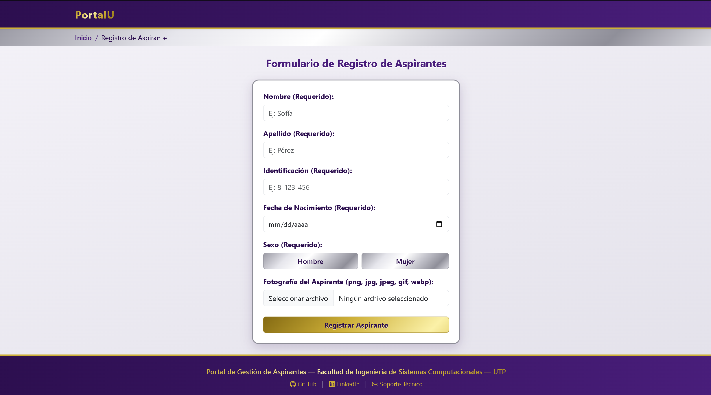
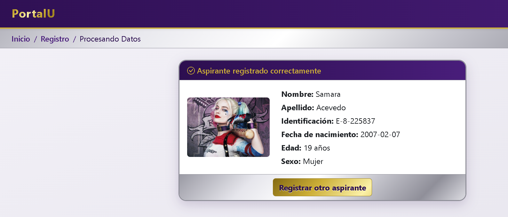
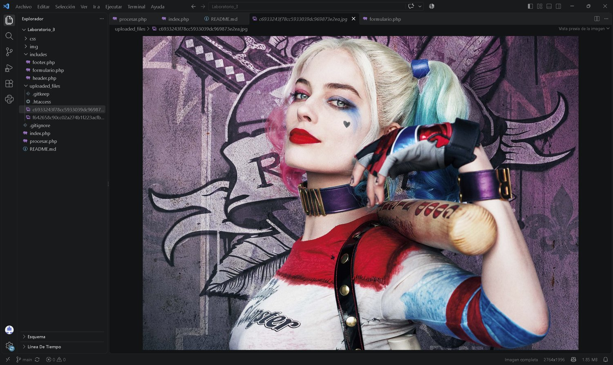

# 🎓 Taller: Registro de Aspirantes

Aplicación web en **PHP + Bootstrap 5.3.8** para registrar aspirantes con validación de datos y carga segura de fotografías, sin base de datos.

> **Laboratorio #3** — Módulo II: Diseño Web con HTML5 y CSS3 / Módulo III: Programación de Aplicaciones Web
> Universidad Tecnológica de Panamá (UTP) — Facultad de Ingeniería de Sistemas Computacionales
> Profesora: Ing. Irina Fong

---

## 🌐 Tecnologías y versiones


| Tecnología | Versión | Uso |
| --- | --- | --- |
| PHP | 7.4 o superior (recomendado 8.x). _Escribe aquí la tuya_ | Lenguaje del backend |
| Bootstrap | 5.3.8 (CDN) | Maquetación y componentes |
| Bootstrap Icons | _(escribe la versión que cargas por CDN)_ | Iconos |
| Apache | _(escribe tu versión, ej. 2.4.x)_ | Servidor web local |
| WampServer | _(escribe tu versión, ej. 3.x)_ | Entorno local |
| Visual Studio Code | _(escribe tu versión)_ | Editor de código |
| HTML / CSS | 5 / 3 | Estructura y estilos (`css/estilos.css`) |

---

## ✨ Características

- Maquetación con **Bootstrap 5.3.8** y etiquetas semánticas: `<header>`, `<main>`, `<section>`, `<footer>`.
- **Modularización con `include`**: navegación, breadcrumb dinámico, formulario y footer en archivos separados.
- **Breadcrumb dinámico** usando `basename($_SERVER['PHP_SELF'])`.
- Formulario por método **POST** con `enctype="multipart/form-data"`.
- **Validaciones en el backend:**
  - Todos los campos son obligatorios.
  - Edad entre **18 y 70 años**, calculada desde la fecha de nacimiento.
  - Extensiones de imagen permitidas: `jpg`, `jpeg`, `png`, `gif`, `webp`.
  - Verificación del tipo MIME real de la imagen y tamaño máximo de 2 MB.
- **Normalización de datos:** nombre y apellido a formato título (`sofía` → `Sofía`) e identificación en mayúsculas.
- **Seguridad:** `trim()`, `strip_tags()`, `htmlspecialchars()`, nombres de archivo aleatorios y carpeta de fotos protegida con `.htaccess`.
- **Diseño personalizado** en morado, dorado metálico y plateado (`css/estilos.css`).
- Meta etiquetas: `viewport`, `author`, `description`, `robots` y `theme-color`.
- Footer con año dinámico (`date('Y')`), contacto, enlaces rápidos y eslogan institucional.

---

## 📁 Detalles del laboratorio

```
Laboratorio_3/
├── css/
│   └── estilos.css          # Tema morado, dorado y plateado
├── img/                     # Imágenes del proyecto y capturas del README
├── includes/
│   ├── header.php           # Metadatos, navbar y breadcrumb dinámico
│   ├── footer.php           # Footer con enlaces y año dinámico
│   └── formulario.php       # Formulario de registro
├── uploaded_files/
│   ├── .htaccess            # Bloquea el acceso directo desde el navegador
│   └── .gitkeep             # Mantiene la carpeta vacía en Git
├── index.php                # Página principal con el formulario
├── procesar.php             # Backend: valida, procesa y muestra el resultado
└── README.md
```

| Archivo | Función |
| --- | --- |
| `index.php` | Carga el header, el formulario y el footer mediante `include` |
| `procesar.php` | Recibe el POST, valida, guarda la foto y muestra el resultado |
| `includes/formulario.php` | Formulario de registro con sus controles |
| `includes/header.php` / `footer.php` | Navegación, breadcrumb y pie de página reutilizables |
| `css/estilos.css` | Estilos personalizados sobre Bootstrap |
| `uploaded_files/` | Carpeta de fotografías, protegida con `.htaccess` |

---

## 🎛️ Controles utilizados

El formulario envía los datos por `POST` a `procesar.php` con `enctype="multipart/form-data"`.

| Campo | Control | Atributos principales |
| --- | --- | --- |
| Nombre | `<input type="text">` | `name="nombre"`, `required`, `maxlength="60"` |
| Apellido | `<input type="text">` | `name="apellido"`, `required`, `maxlength="60"` |
| Identificación | `<input type="text">` | `name="identificacion"`, `required`, `maxlength="20"` |
| Fecha de nacimiento | `<input type="date">` | `name="fecha_nacimiento"`, `required`, `max` calculado con PHP (18 años atrás) |
| Sexo | `<input type="radio">` (Hombre / Mujer) con estilo de botón | `name="sexo"`, clase `btn-check` de Bootstrap |
| Fotografía | `<input type="file">` | `name="foto"`, `required`, `accept=".png,.jpg,.jpeg,.gif,.webp"` |
| Enviar | `<button type="submit">` | "Registrar Aspirante", clase `btn-dorado` |

---

## 🖼️ Evidencia de ejecución

### ➕ Insertar registros

En este laboratorio no hay base de datos: el registro del aspirante se valida y se muestra en pantalla, y la fotografía se guarda en `uploaded_files/`.

**1. Formulario de registro** (`index.php`)



**2. Aspirante registrado correctamente** (`procesar.php`)

Se muestran los datos normalizados, la edad calculada y la fotografía:



**3. Fotografía guardada con nombre aleatorio**

La imagen se guarda en `uploaded_files/` con un nombre generado al azar, no con el nombre original:



### ✏️ Modificar

No aplica en este laboratorio: no hay base de datos, por lo que los registros no se almacenan ni se pueden modificar.

### 🗑️ Eliminar

No aplica en este laboratorio: no hay base de datos, por lo que no hay registros que eliminar.

---

## ⚙️ Requisitos

- PHP 7.4 o superior (recomendado 8.x) con las extensiones `fileinfo` y `mbstring` activas.
- Servidor Apache con `AllowOverride All` (por ejemplo, **WAMP**, XAMPP o Laragon).
- Conexión a internet para cargar Bootstrap y Bootstrap Icons desde CDN.

## 🚀 Procesos de instalación

1. Clona el repositorio dentro de la carpeta pública de tu servidor:

   ```bash
   cd C:\wamp64\www\
   git clone https://github.com/elizaacevedo1024-star/Laboratorio_3.git
   ```

2. Inicia Apache desde WAMP.
3. Abre en el navegador: `http://localhost/Laboratorio_3/index.php`
4. Completa el formulario y presiona **Registrar Aspirante**.

## 🔒 Seguridad de las fotografías

La carpeta `uploaded_files/` contiene un `.htaccess` con `Require all denied`, por lo que las fotos **no se pueden abrir escribiendo su URL** (error 403). Para mostrarlas en la página de resultado, `procesar.php` las lee desde el servidor y las incrusta en base64.

Para verificarlo, intenta abrir `http://localhost/Laboratorio_3/uploaded_files/` en el navegador. Debe mostrar **403 Forbidden**.

---

## 👤 Autora y fecha

**Elizabeth Acevedo Lopez**
Estudiante de licenciatura en Ciberseguridad
Facultad de Ingeniería de Sistemas Computacionales — Universidad Tecnológica de Panamá

- 📧 **Email:** elizabeth.acevedo@utp.ac.pa
- 🌐 **GitHub:** [elizaacevedo1024-star](https://github.com/elizaacevedo1024-star)
- 📅 **Fecha:** 08-10-2026

---

## 📚 Referencias

- Manual de PHP, subida de archivos: https://www.php.net/manual/es/features.file-upload.php
- Manual de PHP, `include`: https://www.php.net/manual/es/function.include.php
- Bootstrap 5.3, documentación: https://getbootstrap.com/docs/5.3/
- MDN, `<input type="file">`: https://developer.mozilla.org/es/docs/Web/HTML/Element/input/file
- OWASP, carga segura de archivos: https://cheatsheetseries.owasp.org/cheatsheets/File_Upload_Cheat_Sheet.html

---

*Proyecto con fines académicos.*
